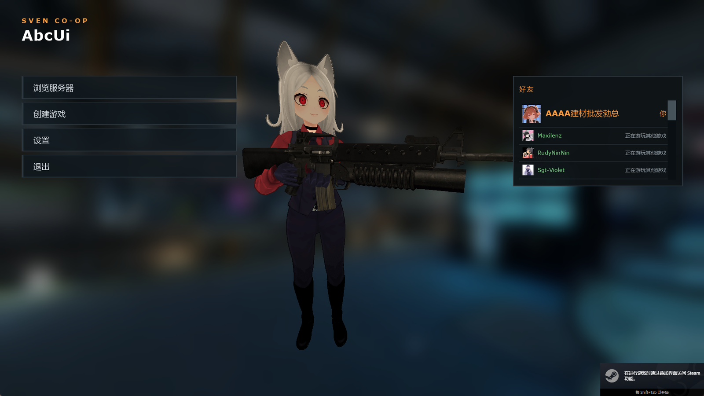
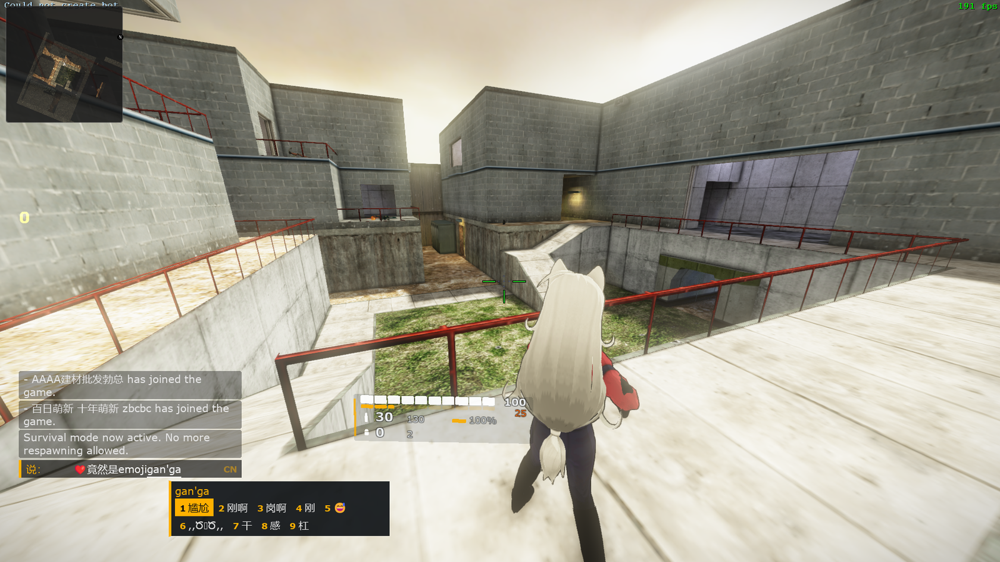
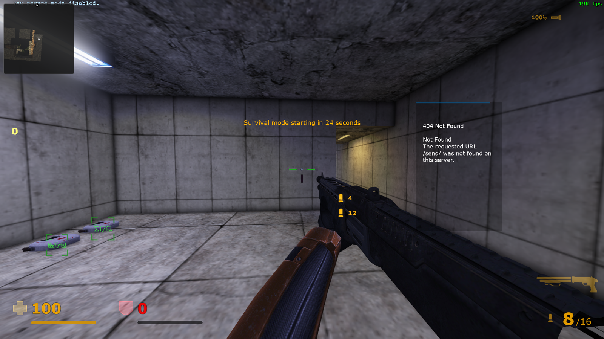

# ABCEnchance

Complete release package of the ABC plugins for Sven Co-op: AbcCore, AbcEssential and AbcUi in one archive, already laid out for the game folder.

## Screenshots



*Main menu*



*Chat emoji and the division HUD*



*Classic HUD*

## Contents

| Package | What it adds |
|---|---|
| AbcCore | Shared library used by both plugins. No interface or settings of its own. |
| AbcEssential | Console search, player models, movement helpers, viewmodel and camera tweaks, effect enhancements. |
| AbcUi | New HUD, chat and menus, including settings, server browser and character preview. |

Each package documents its own features in its README.

Releases ship both HUD groups in one archive. The classic health, ammo and flashlight readouts are enabled; the third-person division group is installed disabled, and turning it on in Settings > Modules turns the classic readouts off.

## Requirements

- Sven Co-op
- MetaHookSV with VGUI2Extension and Renderer
- Microsoft Visual C++ 2015-2022 Redistributable, x86

## Install

Download `ABCEnchance-<tag>.zip` from the releases page and extract it into the Sven Co-op folder. The archive contains `svencoop` at its root, so there is no extra folder to copy:

```text
Sven Co-op/
├── svencoop/
│   ├── abc/
│   │   ├── abcui/
│   │   ├── mdl/
│   │   └── spr/
│   └── metahook/
│       ├── dlls/AbcCore/AbcCore.dll
│       ├── gamedata/abc/
│       └── plugins/
│           ├── AbcEssential.dll
│           └── AbcUi.dll
└── svencoop.exe
```

Then add the plugins to `svencoop/metahook/configs/plugins.lst` in this order:

```text
VGUI2Extension.dll
Renderer.dll
AbcEssential.dll
AbcUi.dll
```

If CaptionMod is installed, `plugins.lst` must list it after `AbcUi.dll` and `StandaloneView.dll` before `VGUI2Extension.dll`, in exactly this order:

```text
StandaloneView.dll
VGUI2Extension.dll
Renderer.dll
AbcEssential.dll
AbcUi.dll
CaptionMod.dll
```

AbcCore.dll is a shared library, not a plugin, so it is not listed in `plugins.lst`; the package already puts it in `svencoop/metahook/dlls/AbcCore/`.

## Build the dist package

Requires Windows, Visual Studio with the C++ workload, CMake 4.2 or newer and Python 3.

```bash
git config --global url."https://github.com/DrAbcOfficial/Renderer".insteadOf "https://github.com/MetaHookSv/Renderer"
git clone --recursive https://github.com/DrAbcOfficial/ABCEnchance.git
cd ABCEnchance
cmake -S . -B build/ci -G "Visual Studio 18 2026" -A Win32
cmake --build build/ci --config Release --parallel
cmake --build build/ci --config Release --target bundle
```

The `dist` target writes `AbcCore-<version>.zip`, `AbcEssential-<version>.zip` and `AbcUi-<version>.zip` to `build/ci/dist`, and `bundle` merges every package found there into `ABCEnchance-game.zip`. The AbcCore package contains the library and the data both plugins need, and each plugin package needs the matching AbcCore package.

With Visual Studio 2022, use `-G "Visual Studio 17 2022"` instead. The Renderer redirect is needed because AbcUi uses a Renderer version from the DrAbcOfficial fork.

Tagged releases publish one merged `ABCEnchance-<tag>.zip` containing all three packages and both HUD groups.

## License

Licensed under the [BSD 3-Clause License](LICENSE).
